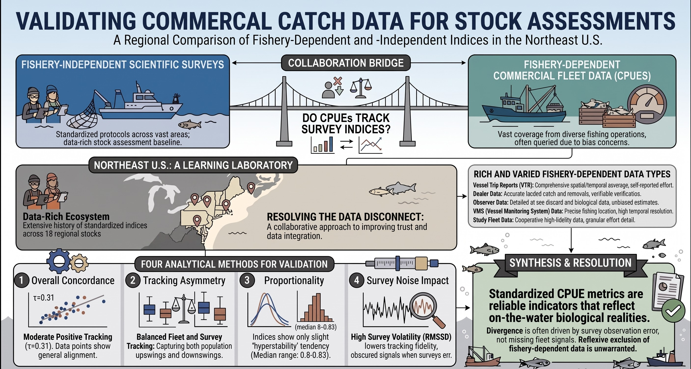

# DRAFT
# Northwest Atlantic CPUE and Survey Index Concordance Analysis

This repository contains the dataset and analytical R code used to evaluate the quantitative fit and directional tracking of standardized commercial catch-per-unit-effort (CPUE) and landings-per-unit-effort (LPUE) indices against fishery-independent surveys. The analyses cover 18 Northwest Atlantic stocks and provide a statistical framework for testing index concordance, survey volatility, and hyperstability.

## Repository Contents

* **Data:** Standardized time-series indices (CPUE, LPUE, and independent scientific surveys) across all 18 evaluated regional stocks.
* **Correlation & Tracking Analyses:** R scripts to calculate Kendall's rank correlation ($\tau$) and Quenouille-Bartlett AR(1)-adjusted Pearson correlations ($r$) to account for time-series non-independence.
* **Volatility Metrics:** Code for computing the Root Mean Square of Successive Differences (RMSSD) to quantify interannual survey observation error.
* **Hyperstability Modeling:** Scripts utilizing Deming regression to estimate proportionality ($\beta$) and test for directional asymmetry or hyperstability while accounting for observation error on both axes.
* **Visualization:** Code to reproduce all manuscript figures, diagnostic plots, and supplementary appendix tables, including tests for CPUE index portfolio effects.

This repository is a scientific product and is not official communication of the National Oceanic and Atmospheric Administration, or the United States Department of Commerce. All NOAA GitHub project code is provided on an ‘as is’ basis and the user assumes responsibility for its use. Any claims against the Department of Commerce or Department of Commerce bureaus stemming from the use of this GitHub project will be governed by all applicable Federal law. Any reference to specific commercial products, processes, or services by service mark, trademark, manufacturer, or otherwise, does not constitute or imply their endorsement, recommendation or favoring by the Department of Commerce. The Department of Commerce seal and logo, or the seal and logo of a DOC bureau, shall not be used in any manner to imply endorsement of any commercial product or activity by DOC or the United States Government.
